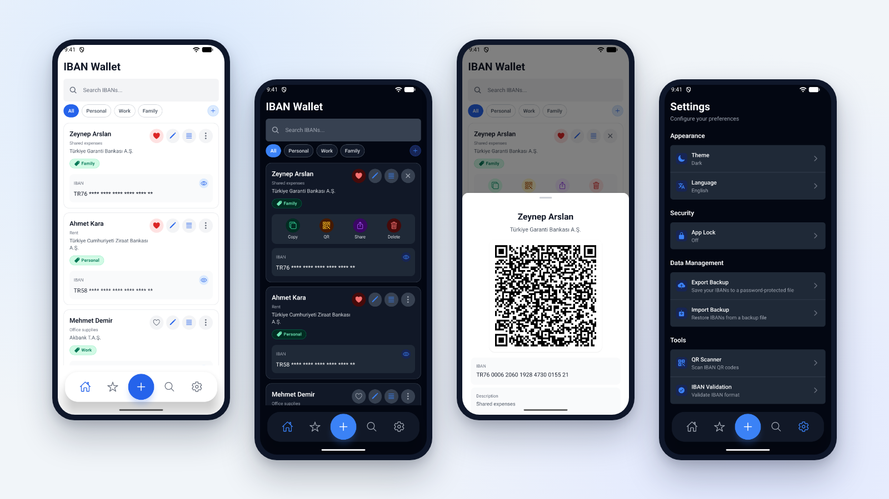
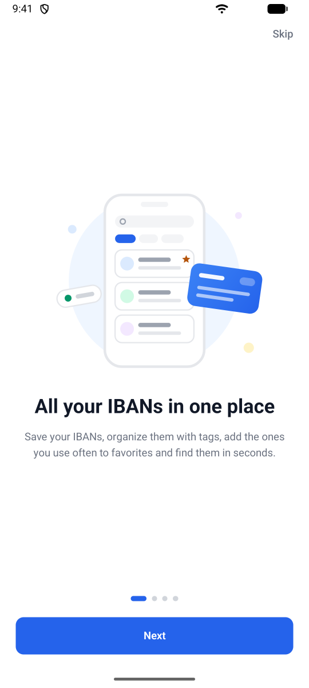
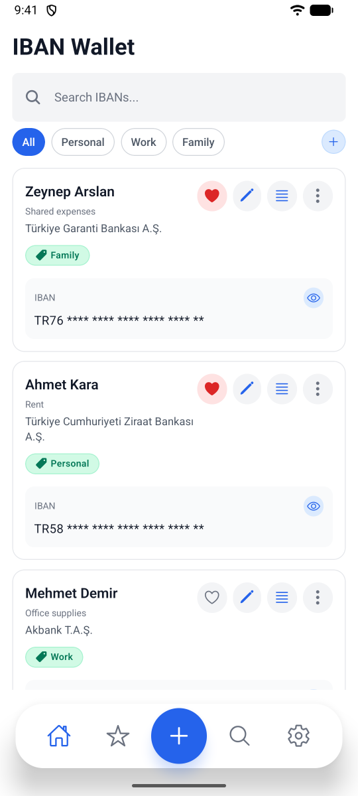
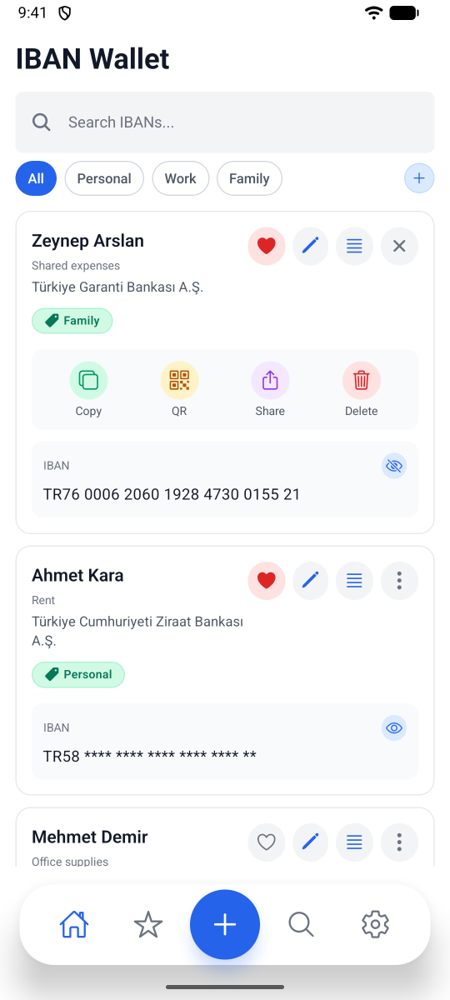
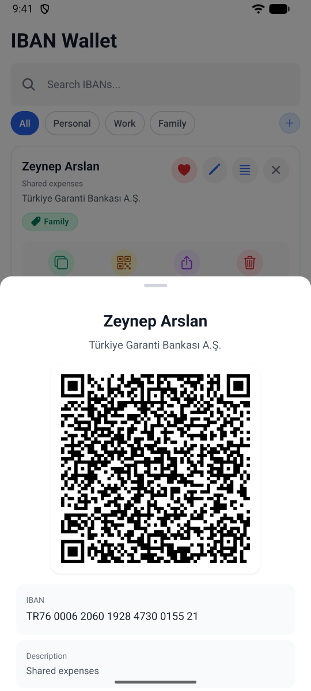
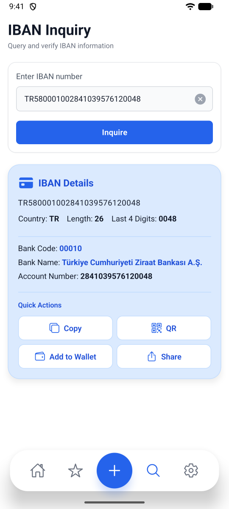
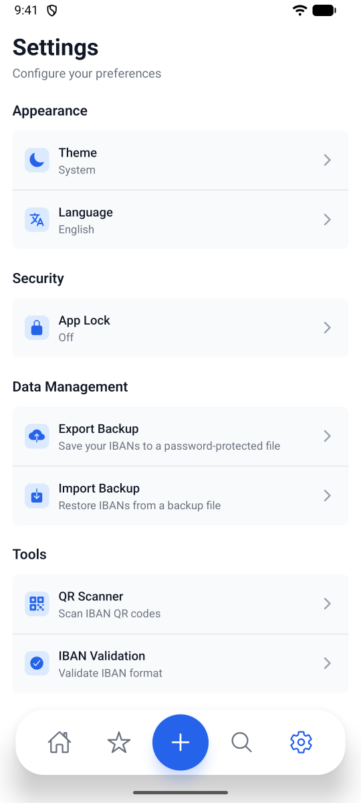
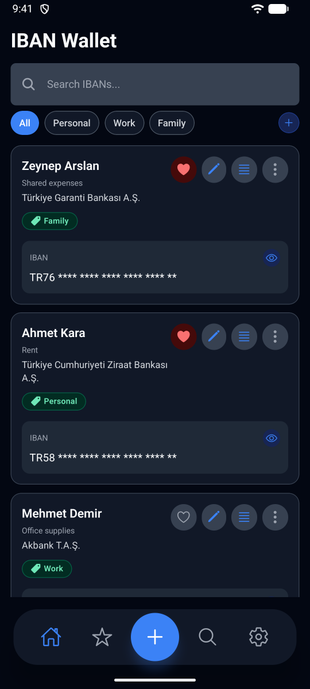
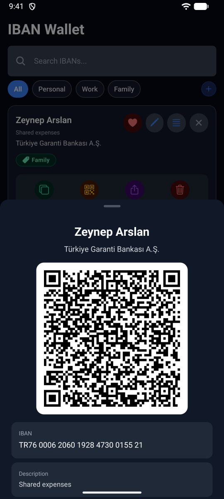
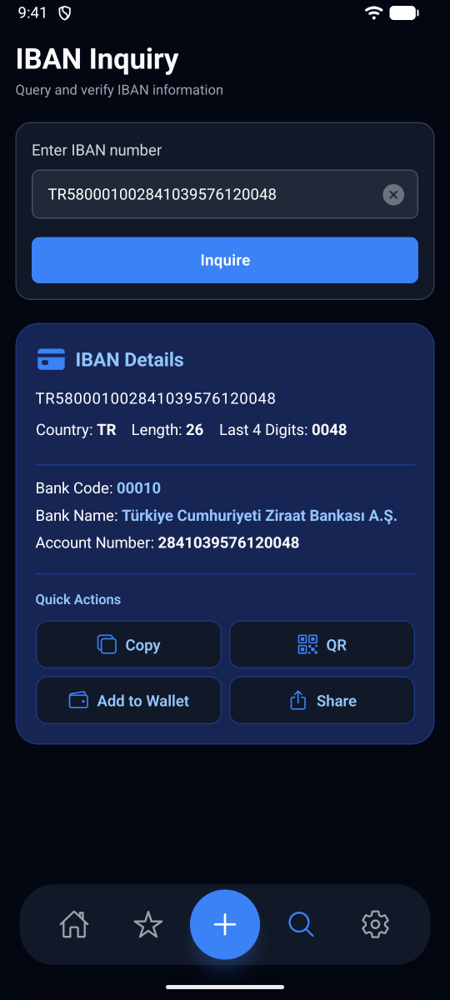

<div align="center">


# IBAN Wallet

**A private, offline wallet for the IBANs you use every day.**

Save, organize, share and check IBANs on iOS and Android. Your data is encrypted and never leaves your device.

**English** · [Türkçe](README.tr.md)

[Website](https://berkanserbes.github.io/iban-wallet-site/en/) · [Privacy policy](https://berkanserbes.github.io/iban-wallet-site/en/privacy/) · [Support](https://berkanserbes.github.io/iban-wallet-site/en/#support)



</div>

## Why IBAN Wallet?

IBANs usually end up scattered across chats, notes and screenshots. IBAN Wallet keeps them in one place, ready to copy, share or show as a QR code, without an account, a server or a cloud.

## Download

Coming soon to the **App Store** and **Google Play**. The links will be added here when the app is live.

## Features

**Organize**
- Save IBANs with a name, a description and one or more tags
- Default tags (Personal, Work, Family) plus your own custom tags
- Favorites, search and tag filters
- Reorder cards by dragging
- Undo right after deleting an IBAN

**Share**
- Copy with one tap, or share through the system share sheet
- Show any IBAN as a QR code
- Add an IBAN by scanning a QR code

**Check an IBAN**
- Validates the IBAN check digits (mod 97)
- For Turkish IBANs, shows the bank name, bank code and account number
- Save the checked IBAN to your wallet in one tap

**Privacy and security**
- IBANs are encrypted with AES-256-GCM. The key is created on the device and kept in the iOS Keychain or Android Keystore
- App lock with Face ID, Touch ID, fingerprint or the device passcode, with auto-lock immediately or after 1 or 5 minutes in the background
- Password-protected backups to move your IBANs to a new phone
- No account, no analytics, no ads and no network requests

**Make it yours**
- Light, dark or system theme
- English and Turkish

## Screenshots

> Taken with demo data. Names and IBANs are fictional.

**Light mode**

| Onboarding | Home | Card actions |
|:---:|:---:|:---:|
|  |  |  |
| **QR code** | **IBAN check** | **Settings** |
|  |  |  |

**Dark mode**

| Home | QR code | IBAN check |
|:---:|:---:|:---:|
|  |  |  |

## Your privacy

IBAN Wallet has no server. The app does not create an account, does not collect analytics and does not send your IBANs anywhere. Everything stays on your device, encrypted.

Your data leaves the app only when you choose to copy or share an IBAN, show a QR code or export a backup.

Read the full [privacy policy](https://berkanserbes.github.io/iban-wallet-site/en/privacy/) ([Türkçe](https://berkanserbes.github.io/iban-wallet-site/privacy/)).

## Support

Questions, bug reports or ideas: [berkanserbes3@gmail.com](mailto:berkanserbes3@gmail.com)

In the app, go to **Settings > Help > Send feedback or report a bug**. The app version and device details are added to the email for you.

## About this repository

This repository holds the IBAN Wallet website, which is served with GitHub Pages. The app's source code is not part of it.

| Page | English | Turkish |
|---|---|---|
| Home and support | [`/en/`](https://berkanserbes.github.io/iban-wallet-site/en/) | [`/`](https://berkanserbes.github.io/iban-wallet-site/) |
| Privacy policy | [`/en/privacy/`](https://berkanserbes.github.io/iban-wallet-site/en/privacy/) | [`/privacy/`](https://berkanserbes.github.io/iban-wallet-site/privacy/) |

```
├── index.html          # Turkish home page
├── privacy/            # Turkish privacy policy
├── en/                 # English home page and privacy policy
├── style.css           # Styles for every page, light and dark theme
├── theme.js            # Light/dark theme toggle
├── 404.html            # Page not found (Turkish and English)
├── sitemap.xml         # Page list with language versions, for search engines
├── icon.svg            # App icon
├── favicon-32.png      # PNG favicon for browsers without SVG icons
├── apple-touch-icon.png # Home screen icon on iPhone and iPad
├── img/                # App screenshots used on the site (tr, en)
└── readme/             # Images used only in the READMEs
```

The site is plain HTML and CSS with one small script for the theme toggle. There is no build step, and it loads no fonts, analytics or other third-party scripts.

**Preview locally:**

```bash
python -m http.server 8000
```

Then open http://localhost:8000. Opening the files directly with `file://` does not work for folder links such as `privacy/`.

**Deploy:** every push to `main` is published by GitHub Pages within a few minutes.

---

<div align="center">

© 2026 Berkan Serbes

</div>
