<div align="center">

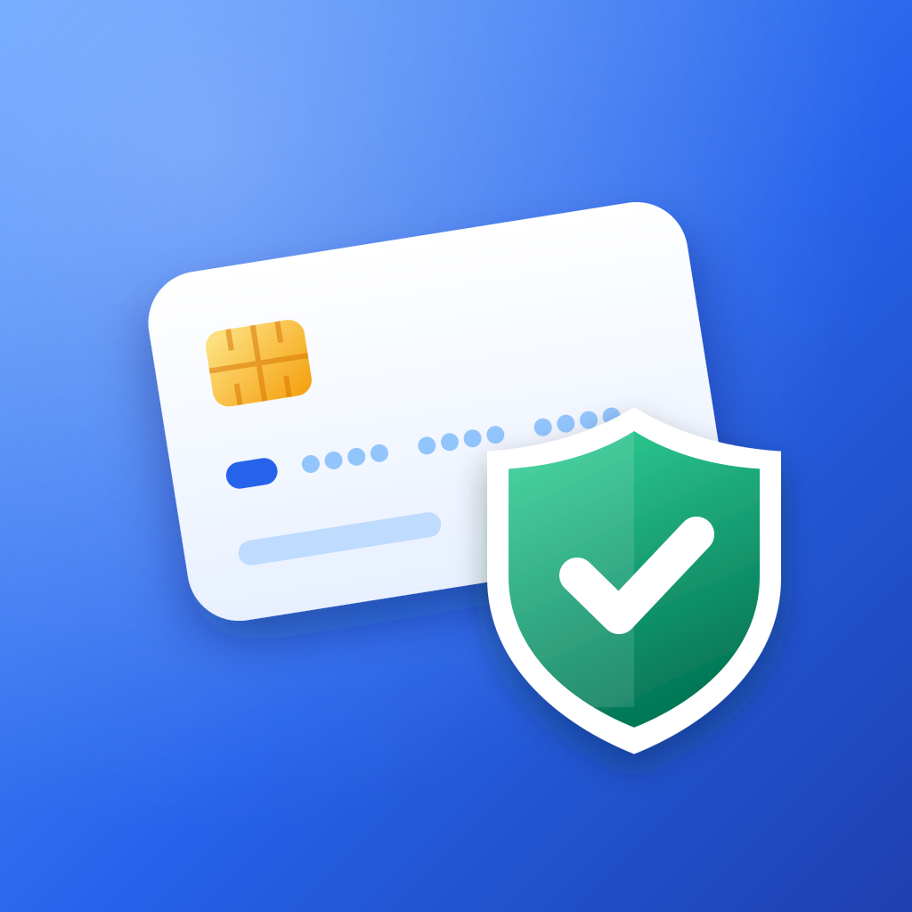

# IBAN Wallet

**Her gün kullandığınız IBAN'lar için gizli ve çevrimdışı bir cüzdan.**

iOS ve Android'de IBAN'larınızı kaydedin, düzenleyin, paylaşın ve doğrulayın. Verileriniz şifrelenir ve cihazınızdan hiç çıkmaz.

[English](README.md) · **Türkçe**

[Web sitesi](https://berkanserbes.github.io/iban-wallet-site/) · [Gizlilik politikası](https://berkanserbes.github.io/iban-wallet-site/privacy/) · [Destek](https://berkanserbes.github.io/iban-wallet-site/#destek)

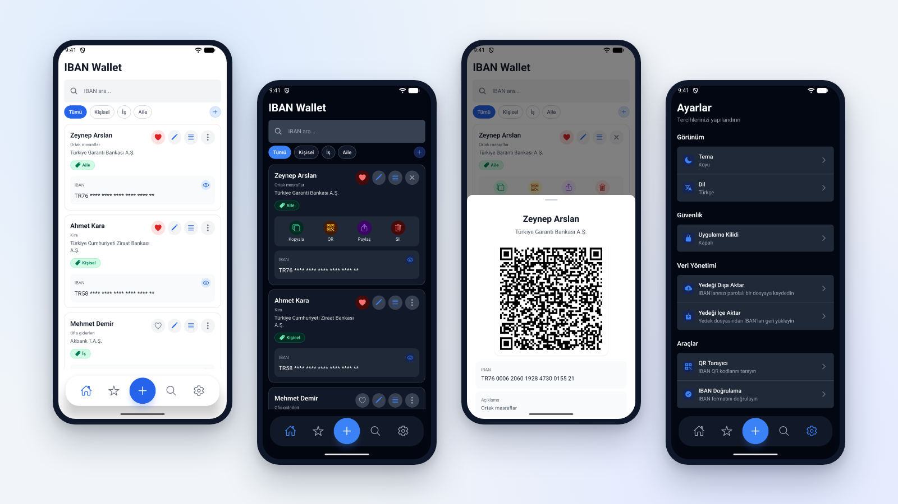

</div>

## Neden IBAN Wallet?

IBAN'lar genelde sohbetlere, notlara ve ekran görüntülerine dağılır. IBAN Wallet onları tek bir yerde toplar; kopyalamaya, paylaşmaya ya da QR kod olarak göstermeye hazır tutar. Hesap, sunucu ya da bulut gerekmez.

## İndir

Yakında **App Store** ve **Google Play**'de. Uygulama yayına girince linkler buraya eklenecek.

## Özellikler

**Düzenleme**
- IBAN'ları isim, açıklama ve bir ya da birden fazla etiketle kaydedin
- Hazır etiketler (Kişisel, İş, Aile) ve kendi etiketleriniz
- Favoriler, arama ve etiket filtreleri
- Kartları sürükleyerek sıralama
- Sildikten hemen sonra geri alma

**Paylaşma**
- Tek dokunuşla kopyalama ya da sistemin paylaşım menüsüyle gönderme
- Her IBAN'ı QR kod olarak gösterme
- QR kod okutarak IBAN ekleme

**IBAN doğrulama**
- IBAN kontrol rakamı (mod 97) doğrulaması
- TR IBAN'larında banka adı, banka kodu ve hesap numarası
- Doğrulanan IBAN'ı tek dokunuşla cüzdana ekleme

**Gizlilik ve güvenlik**
- IBAN'lar AES-256-GCM ile şifrelenir. Anahtar cihazda üretilir ve iOS Keychain'de ya da Android Keystore'da tutulur
- Face ID, Touch ID, parmak izi veya cihaz şifresiyle uygulama kilidi; arka planda hemen, 1 ya da 5 dakika sonra otomatik kilit
- IBAN'ları yeni telefona taşımak için parolalı yedek
- Hesap yok, analitik yok, reklam yok, ağ isteği yok

**Kişiselleştirme**
- Açık, koyu ya da sistem teması
- Türkçe ve İngilizce

## Ekran görüntüleri

> Demo verilerle alındı. İsimler ve IBAN'lar gerçek değildir.

**Açık tema**

| Tanıtım | Ana sayfa | Kart işlemleri |
|:---:|:---:|:---:|
| 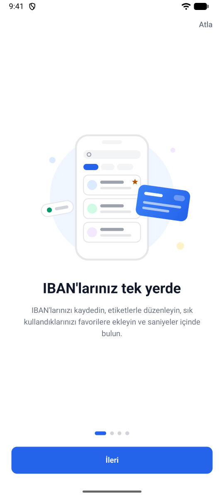 | 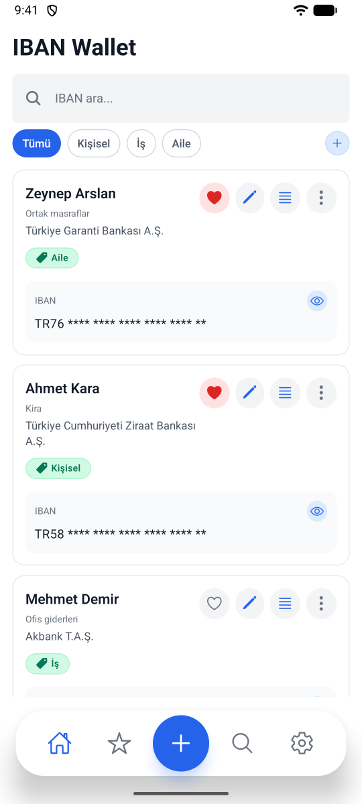 | 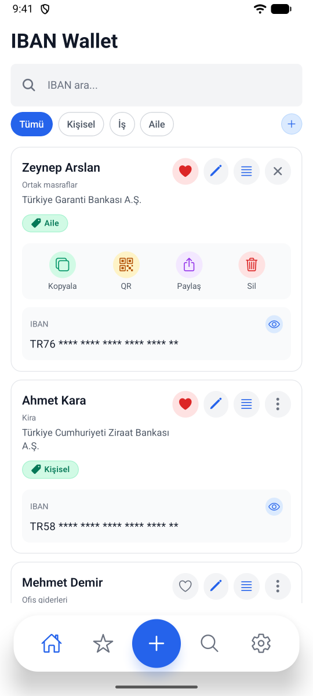 |
| **QR kod** | **IBAN doğrulama** | **Ayarlar** |
| 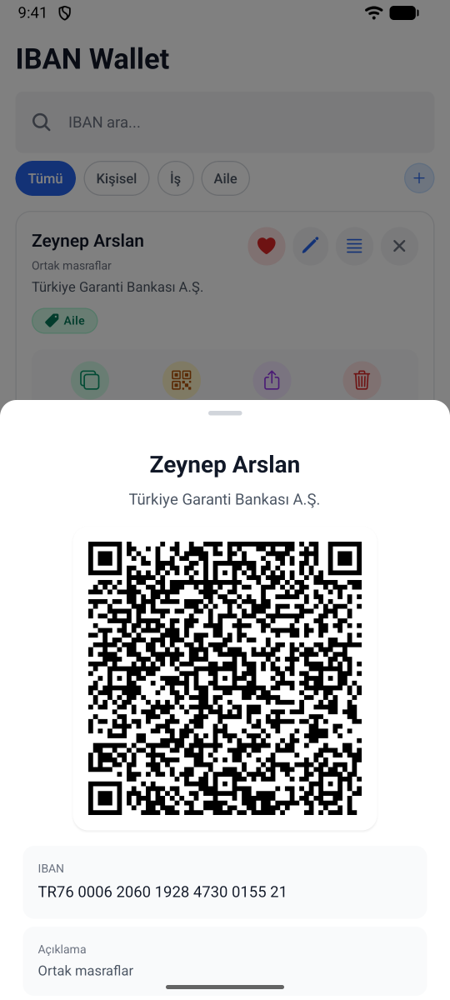 | 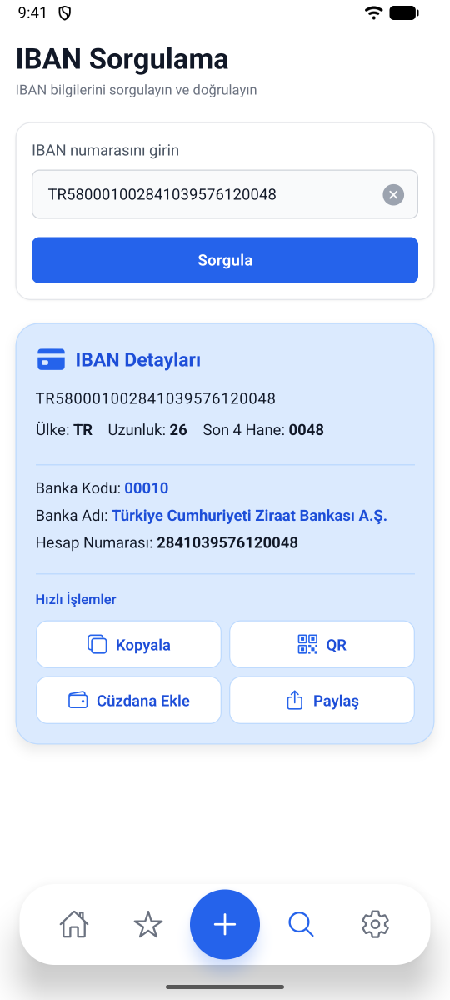 | 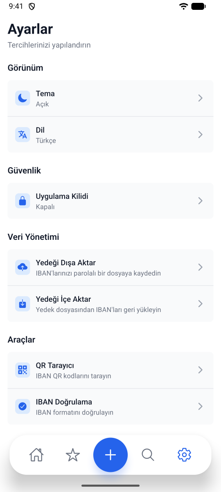 |

**Koyu tema**

| Ana sayfa | QR kod | IBAN doğrulama |
|:---:|:---:|:---:|
| 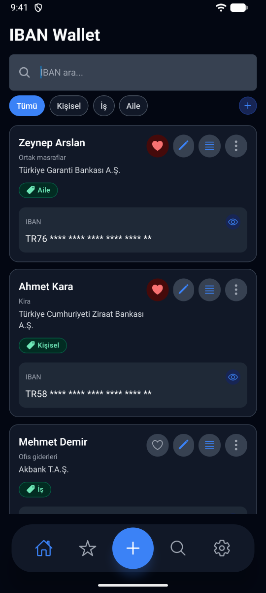 | 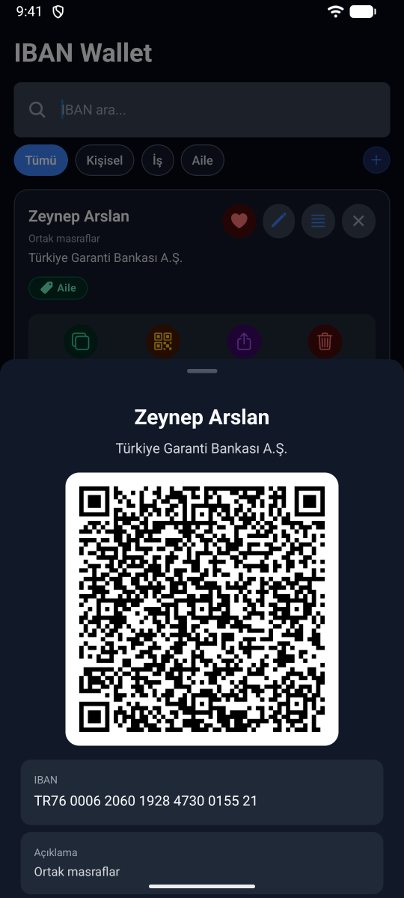 | 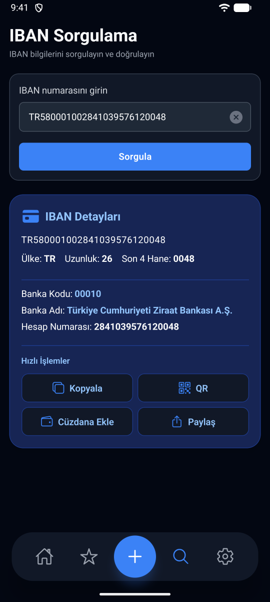 |

## Gizliliğiniz

IBAN Wallet'ın sunucusu yok. Uygulama hesap oluşturmaz, analitik toplamaz ve IBAN'larınızı hiçbir yere göndermez. Her şey cihazınızda, şifreli olarak durur.

Verileriniz uygulamadan sadece siz bir IBAN'ı kopyaladığınızda ya da paylaştığınızda, QR kod gösterdiğinizde veya yedek aldığınızda çıkar.

[Gizlilik politikasının](https://berkanserbes.github.io/iban-wallet-site/privacy/) tamamını okuyun ([English](https://berkanserbes.github.io/iban-wallet-site/en/privacy/)).

## Destek

Sorular, hata bildirimleri ve öneriler için: [berkanserbes3@gmail.com](mailto:berkanserbes3@gmail.com)

Uygulamada **Ayarlar > Yardım > Geri bildirim gönder veya hata bildir** yolunu kullanabilirsiniz. Uygulama sürümü ve cihaz bilgisi e-postaya otomatik eklenir.

## Bu repo hakkında

Bu repo, GitHub Pages ile yayınlanan IBAN Wallet web sitesini içerir. Uygulamanın kaynak kodu bu repoda değildir.

| Sayfa | Türkçe | İngilizce |
|---|---|---|
| Ana sayfa ve destek | [`/`](https://berkanserbes.github.io/iban-wallet-site/) | [`/en/`](https://berkanserbes.github.io/iban-wallet-site/en/) |
| Gizlilik politikası | [`/privacy/`](https://berkanserbes.github.io/iban-wallet-site/privacy/) | [`/en/privacy/`](https://berkanserbes.github.io/iban-wallet-site/en/privacy/) |

```
├── index.html          # Türkçe ana sayfa
├── privacy/            # Türkçe gizlilik politikası
├── en/                 # İngilizce ana sayfa ve gizlilik politikası
├── style.css           # Tüm sayfaların stilleri, açık ve koyu tema
├── theme.js            # Açık/koyu tema düğmesi
├── 404.html            # Sayfa bulunamadı (Türkçe ve İngilizce)
├── sitemap.xml         # Arama motorları için dil sürümleriyle sayfa listesi
├── icon.svg            # Uygulama simgesi
├── favicon-32.png      # SVG simge desteklemeyen tarayıcılar için PNG favicon
├── apple-touch-icon.png # iPhone ve iPad ana ekran simgesi
├── img/                # Sitede kullanılan ekran görüntüleri (tr, en)
└── readme/             # Sadece README'lerde kullanılan görseller
```

Site düz HTML ve CSS'ten oluşur; tema düğmesi için tek bir küçük script vardır. Derleme adımı yoktur; dışarıdan font, analitik ya da başka bir script yüklenmez.

**Yerelde önizleme:**

```bash
python -m http.server 8000
```

Ardından http://localhost:8000 adresini açın. Dosyaları doğrudan `file://` ile açınca `privacy/` gibi klasör linkleri çalışmaz.

**Yayın:** `main` branch'ine yapılan her push, birkaç dakika içinde GitHub Pages tarafından yayınlanır.

---

<div align="center">

© 2026 Berkan Serbes

</div>
